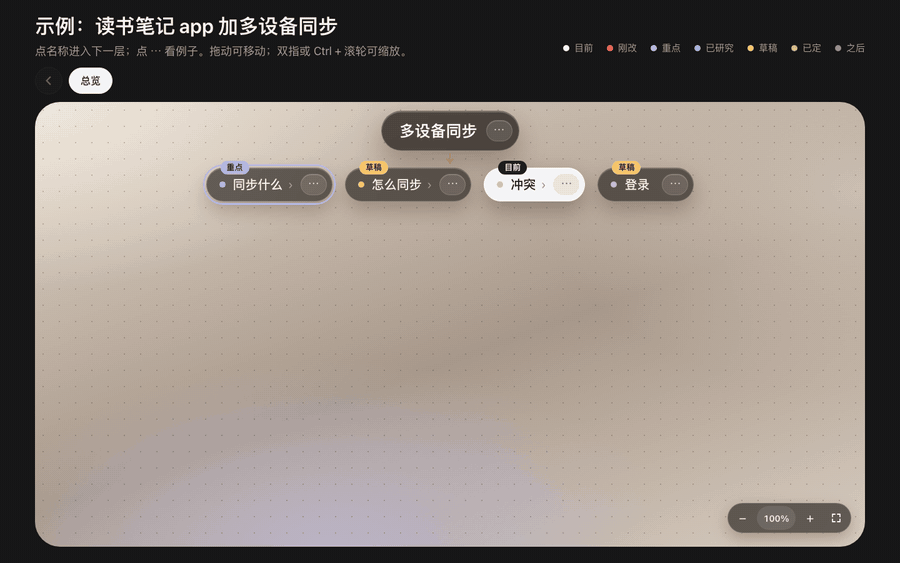

# Live map

**动手之前，先在一张会动的多层地图上和 AI 对齐。不用读长文档，也不用一题一题回答。**

适用于 [Claude Code](https://claude.com/claude-code)，以及其他会读 `SKILL.md` 的 agent。



[English](#english)

## 为什么要用

东西一复杂（很多部分、很多层），模型再强也会漏细节。常见的对齐方式都太扁平：

| 常见做法 | 问题在哪 |
|---|---|
| 写一份长长的 md | 没人会细看，细节就漏了。 |
| 一问一答（grill-me） | 一次只看到一题，看不到整体结构。 |
| 直接写一段长 prompt | 前提是你已经想清楚每个细节，但通常还没有。 |

结果 agent 做出来的东西不对，后面就要还债。

## 怎么运作

1. **AI 把计划画成一棵树**，在浏览器打开。每个画面只有一层，名字短，每格一个例子。
2. **你像看白板一样看。** 点名字进入下一层，点 **⋯** 看例子。拖动可以移动，双指或 Ctrl + 滚轮可以缩放。
3. **你在对话里讨论。** AI 改地图，页面一秒内自动更新，停在你正在看的位置。
4. **只有你能拍板。** 每格一开始都是「草稿」。你在对话里点头，才会变成「已定」。
5. **AI 写出 `BRIEF.md`。** 只把你定了的部分写成要求，没定的另外列出。这就是交给 agent 去做的那段长 prompt，而且每一句都是你定的。

## 安装

```bash
git clone https://github.com/yuet3361/live-map-skill
cp -R live-map-skill/live-map ~/.claude/skills/
```

其他 agent：把 `live-map` 文件夹复制到它读取 skill 的位置。

需要 `python3`（本机预览）、`node`（检查地图）和一个浏览器。不用装任何依赖。

## 使用

直接跟 agent 说，例如：

> 先用 live map 跟我对齐新的付款流程，再写代码。

agent 会运行 `scripts/new-map.sh <项目>`：把地图复制到 `<项目>/docs/live-map/`，在本机找一个空的端口打开，并自动开浏览器。然后一部分一部分跟你过。

想先自己看看示例地图：

```bash
python3 live-map/template/serve.py
```

## 地图上有什么

- **标签：** 已定、草稿、已研究、重点、之后、刚改、目前。
- **带字的箭头**（「然后」「所以要」）表示先后，**底部的地基条**（↑）表示靠什么撑住。
- **数字角标：** 不同分支之间有关联的格，点开可以跳过去。
- **「别人怎么做」对比「我们现在」**：AI 研究过的部分会并排显示。
- **「讨论时改了」**：哪里改了、原本是什么，一眼看到。

界面语言：简体中文、繁體中文、English（在 `data.js` 设 `lang`）。

## 里面有什么

| 路径 | 内容 |
|---|---|
| `live-map/SKILL.md` | agent 照着做的方法 |
| `live-map/template/` | 地图页面。agent 只改 `data.js`，不用编译，没有依赖。 |
| `live-map/reference/data-format.md` | `data.js` 每个字段的说明 |
| `live-map/scripts/new-map.sh` | 在项目里开一张新地图 |
| `live-map/scripts/check.js` | 找出断掉的连接、错的编号和太挤的层 |

## 隐私

预览服务只在本机 `127.0.0.1` 运行，不会上传任何东西。页面会从 Google Fonts 载入字体。

## English

A skill that aligns you and your AI agent on a complex plan before it builds anything. The agent draws the plan as a live, clickable, multi-level map in your browser. You read it like a board (drag, zoom), decide part by part in chat, and the map updates within a second. Only you can mark a part as decided. At the end, the agent writes `BRIEF.md` from what you decided: the long prompt for the build.

Install: copy the `live-map` folder to `~/.claude/skills/`. Then ask your agent: "Plan this with me on a live map before you write code." Set `lang: 'en'` in `data.js` for English labels.

## 许可

[MIT](LICENSE)
