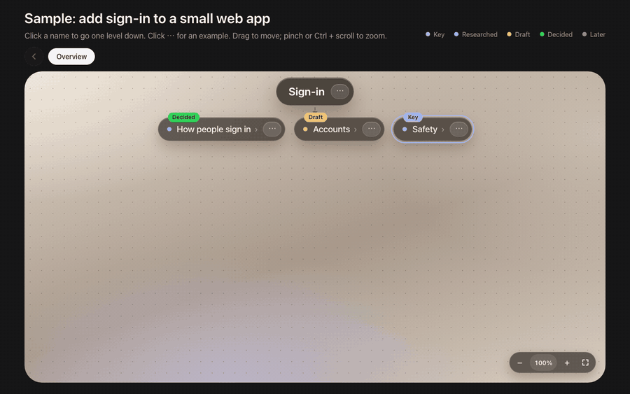

# Live map

**Align with your AI on a complex plan before it builds anything — on a live, clickable map instead of a long spec.**

A skill for [Claude Code](https://claude.com/claude-code) and other agents that read `SKILL.md`.



## Why

Even the strongest models miss details when a task has many parts and levels. The usual ways to align are flat:

| Usual way | What goes wrong |
|---|---|
| A long spec in Markdown | Few people read it closely. Details slip. |
| Question-by-question interview ("grill me") | You see one question at a time, never the whole structure. |
| Just write a long prompt | Fine if you already know every detail. Usually you don't yet. |

The agent then builds the wrong thing, and you pay it back later.

## How it works

1. **The AI draws the plan as a tree** in your browser. One level per screen, short names, one example per node.
2. **You read it like a board.** Click a name to go down a level. Click **⋯** for an example. Drag to move, pinch or Ctrl + scroll to zoom.
3. **You discuss in chat.** The AI edits the map and the page updates within a second, without losing your place.
4. **Only you decide.** Every node starts as **Draft**. It becomes **Decided** only when you say yes in chat.
5. **The AI writes `BRIEF.md`** from what you decided, with what is still open listed separately. That is the long prompt for the build, and every line of it is yours.

## Install

```bash
git clone https://github.com/yuet3361/live-map-skill
cp -R live-map-skill/live-map ~/.claude/skills/
```

For other agents, copy the `live-map` folder to wherever they load skills from.

Needs `python3` (local server), `node` (map checker) and a browser. No packages to install.

## Use

Ask your agent, for example:

> Plan the new billing system with me on a live map before you write any code.

> 先用 live map 跟我对齐，再动手。

The agent starts the map with `scripts/new-map.sh <project>`. It copies the map into `<project>/docs/live-map/`, serves it on a free local port and opens your browser. Then it goes through the plan part by part with you.

Try the sample map by hand:

```bash
python3 live-map/template/serve.py
```

## What the map shows

- **Badges:** Decided, Draft, Researched, Key, Later, Just changed, Now.
- **Arrows with words** ("then", "so we need") for order, and a **foundation band** (↑) for what holds the rest up.
- **Number badges** for links between parts in different branches.
- **"How others do it" vs "ours now"** boxes when the AI has researched a part.
- **"Changed while we talked"** boxes, so you see what moved and why.

Interface languages: English, 繁體中文, 简体中文 (set `lang` in `data.js`).

## What is inside

| Path | What |
|---|---|
| `live-map/SKILL.md` | The method the agent follows |
| `live-map/template/` | The map page. The agent edits only `data.js`. No build step, no dependencies. |
| `live-map/reference/data-format.md` | Every `data.js` field |
| `live-map/scripts/new-map.sh` | Starts a new map in a project |
| `live-map/scripts/check.js` | Finds broken links, bad indexes and crowded levels |

## Privacy

The server listens on `127.0.0.1` only. Nothing is uploaded. The page loads fonts from Google Fonts.

---

## 中文说明

复杂的东西，模型再强也会漏细节。长长的 md 没人细看；一问一答式的 grill-me 只看到一题，看不到整体结构。

这个 skill 让 AI 先把计划画成**即时、可点开的多层地图**：

- 每个画面只有一层，名字短，点名字进下一层；点 **⋯** 看一个短例子。
- 像一块白板：拖动可移动，双指或 Ctrl + 滚轮可缩放。
- 标签分「已定／草稿／已研究／之后」。只有你在对话里点头，才会变「已定」。
- 你在对话里讲，AI 改地图，浏览器一秒内自动更新，停在你正在看的位置。
- 对齐完，AI 只用你定了的部分写出 `BRIEF.md`，就是交给 agent 一次做完的那段长 prompt。

安装：把 `live-map` 文件夹复制到 `~/.claude/skills/`，然后跟 agent 说：「先用 live map 跟我对齐再动手。」

## License

[MIT](LICENSE)
